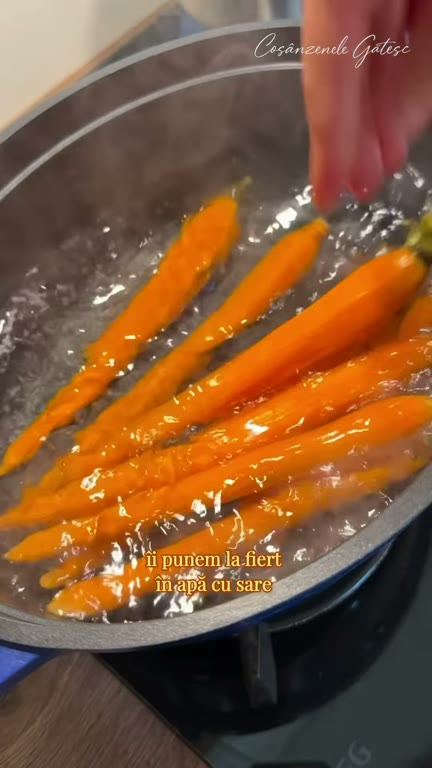
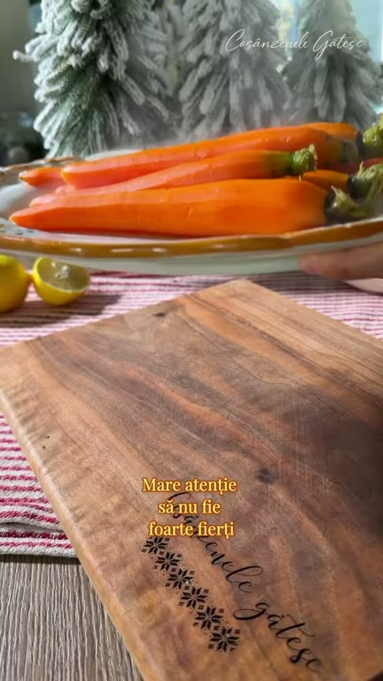
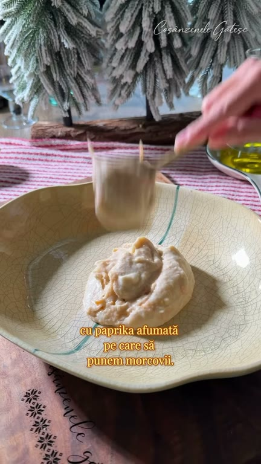

> **INCOMPLETE RESULT (partial). Read stage warnings before using these notes.**

# recipe

## Metadata

- URL: https://www.instagram.com/reels/Df481Z9MknK/
- Author: COSANZENELE GATESC
- Caption: Salvati de acum reteta pentru ca anul acesta promitem sa aveti numai bunatati pe mesele de sarbatori. Ne apucam de treaba?

📝Lista ingrediente: 
- morcovi subtiri (ar fi bine sa fie de aceeasi dimensiune);
- cateva fasii de bacon; 
- o lingurita de mustar; 
- 2 lingurite de miere; 
- o lingurita de suc de lamaie; 
- patrunjel;
- sare si piper proaspat macinat; 

🧑🏻‍🍳Mod de pregatire: 

Alegem morcovi de grosimi cat mai apropiate ca sa se gateasca uniform. Ii curatam de coaja, ii spalam bine si ii punem la fiert in apa cu sare, pana cand furculita intra usor in ei. Mare atentie sa nu fie foarte fierti pentru ca se pot rupe.

Ii lasam sa se raceasca, apoi infasuram fiecare morcov in fasii de bacon. Ii aranjam pe o tava si ii bagam direct la cuptor (200 de grade pana cand baconul devine crocant). 

Intre timp, pregatim sosul: mustar, miere, suc de lamaie, sare si piper si patrunjel proaspat. 

Noi am pregatit si o crema de fasole cu paprika afumata pe care sa punem morcovii. Puteti face si hummus sau un piure de telina coapta. Rezultatul? O bunatate la care nu ai cum sa rezisti. Urmariti Cosanzenele Gatesc pentru mai multe delicii!
- Engine: llamacpp (live)

## Structured notes

Unavailable; inspect timeline and stage diagnostics.

## Reference frames

## Visual timeline

## Transcript

No observations; inspect the corresponding stage status below.

## On-screen text

No observations; inspect the corresponding stage status below.

## Stages

-  / fetch: **complete** (3.333s) 
- media-1 / normalize: **complete** (0.166s) 
- media-1 / asr: **unavailable** (0.040s) ffmpeg output is not 16 kHz mono PCM WAV: expected a standard 16 kHz, mono, signed 16-bit PCM WAV file
- media-1 / frames: **complete** (7.458s) 
- media-1 / ocr: **unavailable** (0.122s) parse tesseract TSV for "out\\run-2251928235\\media-1\\frame_000001.jpg": empty TSV output
-  / inference_readiness: **unavailable** (0.028s) resolve gpu.device 1 with nvidia-smi: nvidia-smi unavailable: install it and configure its executable/PATH: exec: "nvidia-smi": executable file not found in %PATH%
-  / structure: **skipped** (0.000s) no available model or supporting evidence

## Warnings

- media-1/asr: ffmpeg output is not 16 kHz mono PCM WAV: expected a standard 16 kHz, mono, signed 16-bit PCM WAV file
- media-1/ocr: parse tesseract TSV for "out\\run-2251928235\\media-1\\frame_000001.jpg": empty TSV output
- /inference_readiness: resolve gpu.device 1 with nvidia-smi: nvidia-smi unavailable: install it and configure its executable/PATH: exec: "nvidia-smi": executable file not found in %PATH%
- /structure: no available model or supporting evidence
- GPU memory was not monitored; hardware budget is unverified.
